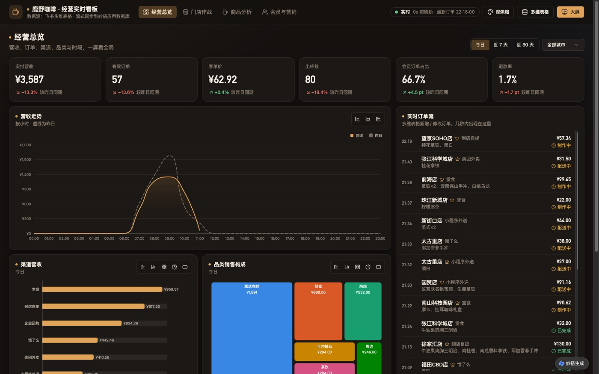
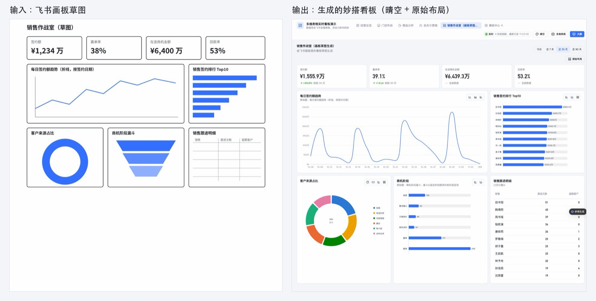
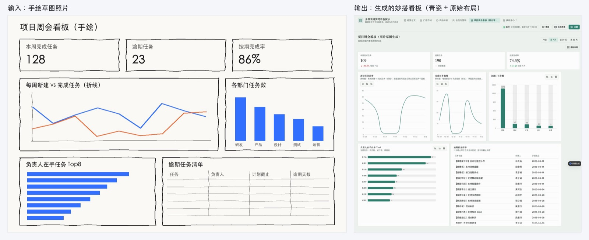
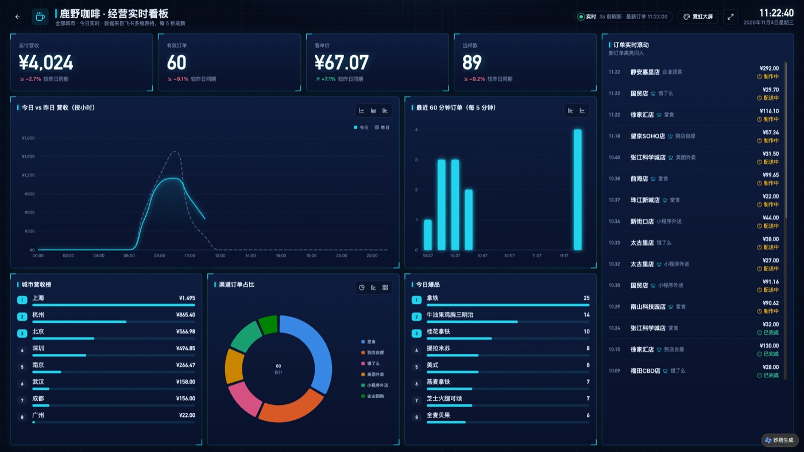
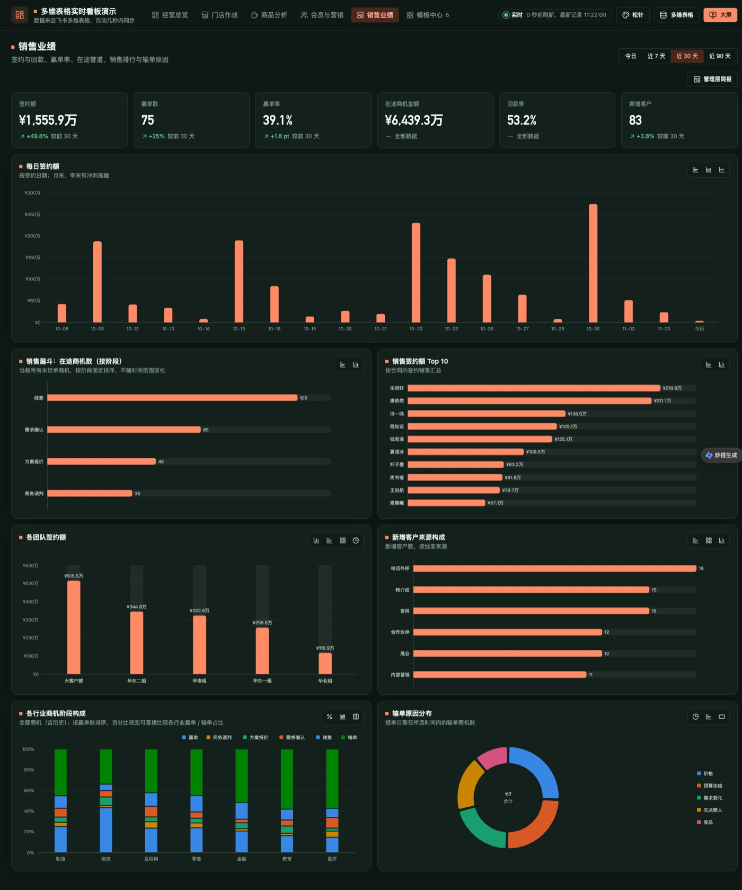
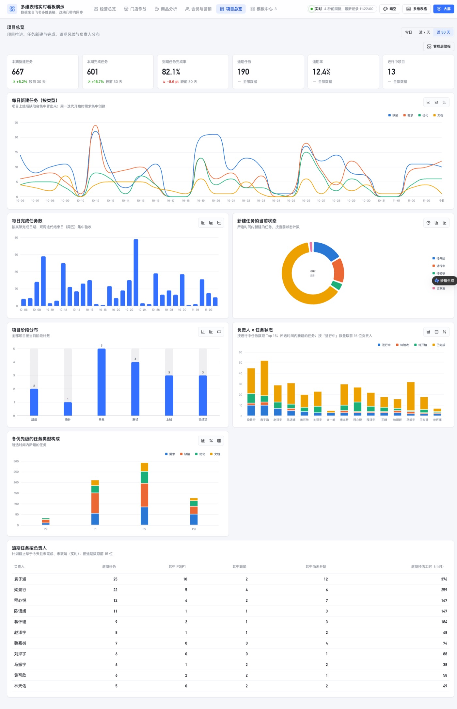
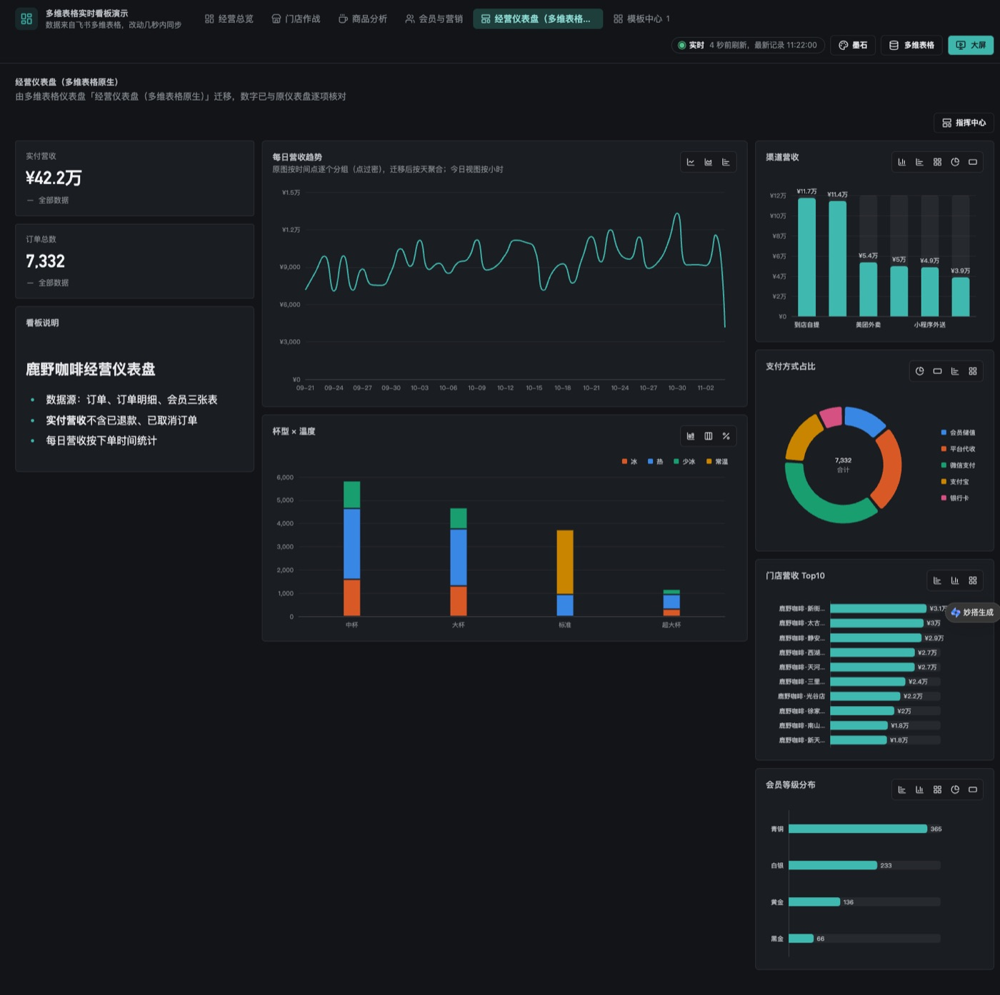
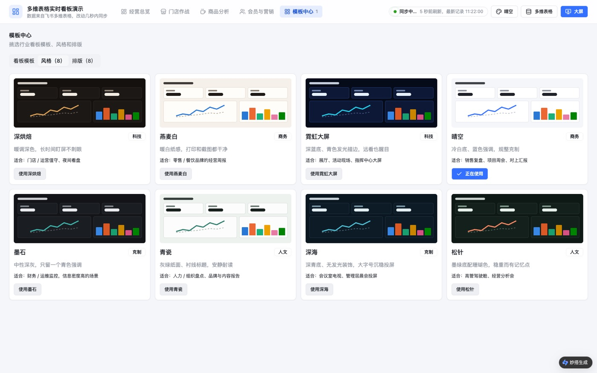
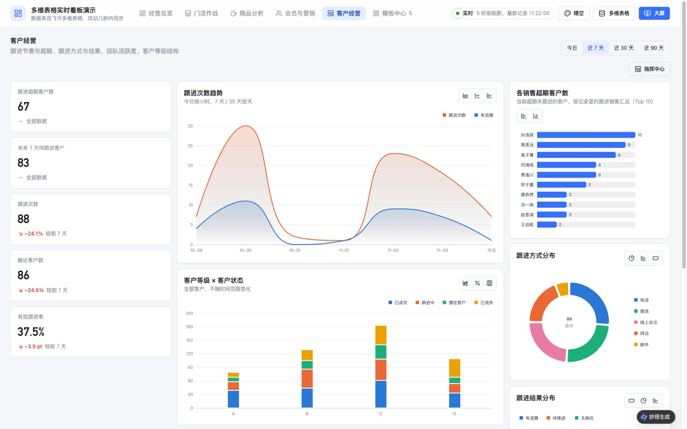

# 飞书多维表格实时看板 · Agent Skill

> 非官方社区项目，与飞书 / 字节跳动无隶属关系。「妙搭」指飞书妙搭（Feishu Miaoda），不是百度秒哒。

把**飞书多维表格**变成部署在**飞书妙搭**上的**实时数据看板**。在 Claude Code 里说一句「把这个多维表格做成实时看板」，skill 会建应用、配同步、生成看板、截图自检，最后发布上线。改表后 5~10 秒，看板就会跟着变。



## 和别的方案有什么不同

```
飞书会议纪要 ─┐
原生仪表盘 ────┤
飞书画板 / 图片 ┼─► dashboard-spec.json ─► 看板引擎（不用写查询）─┐
行业模板 ─────┘                                                ├─► 妙搭看板：8 风格 × 8 排版
网站公开数据 ─web-to-base─► 飞书多维表格 ──流式同步（秒级）──► 应用数据库 Postgres ──5 秒轮询──┘
```

- **原生仪表盘一键迁移，数字逐项核对**：读取多维表格仪表盘的每个组件，生成新看板，再逐面板对比原值。演示中 8 个面板全部一致：
  ```
  🟢 实付营收        一致（1 项）   __total__=422425.63
  🟢 门店营收 Top10  一致（10 项）  鹿野咖啡·新街口店=30534.75 …
  🟢 每日营收趋势    一致（35 项）
  核对完成：🟢 一致 8 · 🔴 不一致 0
  ```
- **真·实时**：多维表格通过妙搭官方流式同步进 Postgres，看板 5 秒轮询；改表到上屏实测约 5 秒
- **需求可以来自会议**：从飞书会议逐字稿提炼指标、口径、受众和风格偏好，每个图表都能追溯到「谁说的哪句话」
- **开箱即用的行业模板**：零售连锁（5 个精排看板 + 投屏大屏）、工作管理、客户管理，自带有业务规律的演示数据
- **专业而不模板化**：8 套风格都经过色盲与对比度校验；同一实体在所有图里同色；需求说明有设计检查，交付前截图自检

开源社区里没有覆盖这整条链路的项目，详见 [同类项目与定位](docs/landscape.md)。

## 四种输入，一套产出

| 你手上有 | 怎么识别 | 产出 |
|---|---|---|
| 一场需求会（飞书会议） | 读逐字稿原话，提炼受众、指标口径、预警、风格偏好 | 看板 + 需求溯源表（每个图表对应谁说的哪句话） |
| 多维表格原生仪表盘 | 读每个组件的类型、表、指标、维度、筛选、布局 | 看板 + 迁移报告 + 逐面板数字核对 |
| 飞书画板里画的样子 | 读画板原生节点：框的位置、标题、折线 / 柱条 / 圆环 / 梯形 / 网格等图形特征 | 线框稿 → 看板 + 待确认问题 + 对照图 |
| 一张图片（手绘拍照、别家 BI 截图、设计稿） | 视觉识别，规则同画板 | 同上 |

每个面板用「标题关键词 + 图形特征」两路证据识别图表类型，再把标题里的业务词对到多维表格的表和字段。拿不准的（比率口径、「逾期」的定义、一条线还是两条线）一律变成选择题让你确认，不瞎猜。

**飞书画板草图 → 看板**（9 个面板全部识别正确，指标与专家手写的模板数字一致）



**手绘照片 → 看板**（双折线按日期口径自动拆成两个面板，「逾期任务清单」生成逐条记录清单）



## 还没有数据？先从网站抓进多维表格

仓库里的第二个 skill `web-to-base` 引导你把网页上的**公开**表格 / 列表抓下来，存进多维表格，再接到实时看板：

```
网址 ─► 合规检查（robots.txt、≥2 秒间隔、可识别的 User-Agent）
     ─► 识别页面里的数据块（表格 / schema.org 结构化数据 / 重复列表）并预览
     ─► 推断字段类型（数字去千分位与单位、日期、链接、单选）
     ─► 写入多维表格：按主键新增或更新，自动补「来源链接」「抓取时间」
     ─► （可选）定期重跑 ─► （可选）交给看板 skill
```

以维基百科「省级行政区地区生产总值列表」为例：

```
合规检查：robots.txt 允许
| 数据块 | 类型 | 标题 | 行数 | 列 |
| t1     | 表格 | …    | 33   | 地区、GDP (百万人民币)、GDP (百万美元)、占比 (%)、实际增幅 (%)、名义增幅 (%) |
✓ 新增 33 条、更新 0 条          # 第一次
✓ 新增 0 条、更新 33 条          # 再跑一次
```

重复运行只会更新已有记录、补充新记录，不会删数据。需要登录、付费墙后面的内容、个人信息、robots.txt 不允许的页面，skill 会停下并建议改用官方 API 或数据下载页，详见 [合规说明](skills/web-to-base/references/compliance.md)。

## 截图

| 投屏大屏（霓虹） | 客户管理·销售业绩（松针） |
|---|---|
|  |  |
| **工作管理·项目总览（晴空 + 管理层简报）** | **迁移来的看板（墨石 + 指挥中心）** |
|  |  |
| **模板中心：8 套风格** | **客户经营（晴空 + 指挥中心）** |
|  |  |

## 快速开始

**前置条件**
- [Claude Code](https://claude.com/claude-code)（或其他支持 Agent Skills 的客户端）
- 飞书 [`lark-cli`](https://github.com/larksuite/cli) ≥ 1.0.98，已登录，具备多维表格与妙搭应用权限；并安装其 `lark-base`、`lark-apps`（会议来源再加 `lark-meeting`）skill
- Git、Node.js ≥ 22、Python ≥ 3.9

**安装 skill**

```bash
# 方式一：skills CLI（会列出仓库里的两个 skill 供选择）
npx skills add xignzuan5/feishu-base-live-dashboard
# 方式二：手动复制
git clone https://github.com/xignzuan5/feishu-base-live-dashboard.git
cp -R feishu-base-live-dashboard/skills/miaoda-base-live-dashboard ~/.claude/skills/
cp -R feishu-base-live-dashboard/skills/web-to-base ~/.claude/skills/   # 可选：网站数据抓取
```

**让它主动出现**

两个 skill 的描述已经写成「遇到搭看板 / 仪表盘 / 大屏 / BI 报表需求就主动使用」，激活后会先走一段引导：用选择框问清数据在哪、给谁看、要不要发布，再用任务列表一步步展示进度。如果你希望团队里的 Claude 更稳定地用它，可以在项目或个人的 `CLAUDE.md` 里加一句：

```markdown
遇到搭建数据看板、仪表盘、驾驶舱、大屏、BI 报表的需求时，优先使用 miaoda-base-live-dashboard skill；
数据还在网站上时，先用 web-to-base skill 抓进飞书多维表格。
```

**然后直接说**

- 「把这个多维表格做成实时看板，给老板周会用：<多维表格链接>」
- 「我们多维表格里有个『销售仪表盘』，搬到妙搭上，数字要和原来一样」
- 「根据昨天下午的看板需求会，出一个客户管理看板」
- 「照着这块画板里画的样子做个看板：<画板 / 文档链接>」
- 「这是我们在别的 BI 里的看板截图，用多维表格的数据在妙搭上做一个一样的」
- 「做一个工作管理的演示看板，风格大气一点」
- 「把这个网页上的表格抓进多维表格，每周更新一次，再做成看板：<网址>」

完整流程见 [SKILL.md](skills/miaoda-base-live-dashboard/SKILL.md)；大家会怎么用见 [用户故事](docs/user-stories.md)。

## 能力一览

| 能力 | 内容 |
|---|---|
| 需求来源 | 飞书会议 / 原生仪表盘迁移 / 飞书画板 / 图片 / 行业模板 / 现场问答，统一产出 `dashboard-spec.json` |
| 看板引擎 | 需求说明 → SQL：条件指标、比率、相对日期、字段对比、关联表字段分组、固定顺序、Top N |
| 风格 | 深烘焙、燕麦白、霓虹大屏、晴空、墨石、青瓷、深海、松针 |
| 排版 | 原始布局、管理层简报、指挥中心、分析工作台、个人工作台、记分对比、杂志式、单列聚焦 |
| 面板 | 指标卡、趋势、构成 / 排行、堆叠、热力、散点、进度、实时订单流、汇总表、记录清单；每个面板可切换 3~5 种图表 |
| 质量 | 迁移口径核对（`verify_spec_board.py`）、设计检查（`lint_spec.py`）、截图自检、配色校验 |
| 运维 | 逐表建同步、线上断点续传（`--heal`）、3 秒短缓存保护数据库连接 |
| 安全 | 界面只显示友好提示，SQL、表名、堆栈只进服务端日志；浏览器控制台留排查编号，同一错误只记一次 |
| 数据来源 | `web-to-base`：网页公开表格 / 列表 → 多维表格，遵守 robots.txt 与请求间隔，按主键增量更新 |

## 仓库结构

```
skills/web-to-base/       # 网站公开数据 → 多维表格（抓取、识别、类型推断、按主键更新）
skills/miaoda-base-live-dashboard/
├── SKILL.md              # Agent 执行流程（入口，含激活后的引导）
├── README.md             # 上架 skill 市场用的简介与 3 分钟演示脚本
├── scripts/              # 造数、同步、迁移、核对、设计检查、编译、安装
│   └── domains/          # 行业领域包（工作管理、客户管理）
├── template/             # 装进妙搭全栈应用的代码（NestJS + React + ECharts）
├── assets/               # 行业模板需求说明、同步计划、迁移示例
└── references/           # 需求格式、目录、会议梳理、设计质量、改造指南、踩坑
docs/                     # 用户故事、同类项目、截图
```

## 路线图

- [ ] 指标层：口径定义一次，面板引用指标 id
- [ ] 全局变量与阈值告警（推送飞书群）
- [ ] 对话改看板：自然语言改需求说明，先预览差异
- [ ] 无账号体验：mock 数据 + 本地 Postgres，不登录飞书也能跑
- [ ] 更多行业领域包：客服工单、招聘、进销存
- [ ] 反向导出为多维表格仪表盘插件

## 贡献

- **新增行业领域包**：写 `scripts/domains/<领域>.py`（表结构 + 造数）和 `assets/specs/<领域>.spec.json`，不需要改前后端代码；跑 `lint_spec.py` 与 `build_spec_bundle.py` 无报错后提 PR
- **新增风格**：在 `template/client/src/dashboard/theme/` 加配色与样式变量，并用色盲 / 对比度校验通过
- 踩到新坑请补进 `references/pitfalls.md`

## License

[MIT](LICENSE)

---

**English summary** — An Agent Skill that turns a Feishu (Lark) Base into a live dashboard app on Feishu Miaoda: Base tables are stream-synced into Postgres, the board polls every 5 s, and requirements can come from meeting transcripts, an existing Base dashboard (migrated with per-panel number verification), or vertical templates (retail, work management, CRM). Requirements can also come from a Feishu whiteboard sketch or a screenshot. A companion skill, `web-to-base`, scrapes public web tables into a Base (robots.txt-aware, rate-limited, upsert by key). Includes 8 validated visual styles, 8 layout archetypes, a spec-driven query engine, a design linter and seed-data generators. Unofficial community project.
